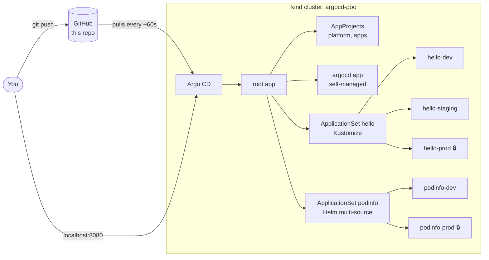

# Argo CD POC: GitOps on a local Kubernetes cluster

[](https://github.com/CarlosRiggio/ArgoCD-POC/actions/workflows/ci.yaml)

A small, fully reproducible **Argo CD v3.6** setup that runs on your laptop with
[kind](https://kind.sigs.k8s.io/). One command creates a cluster, installs Argo CD,
and lets Argo CD deploy everything else **from this Git repo**.

```bash
make up      # ~3-5 minutes: cluster + Argo CD + 7 applications
make info    # URLs + admin password
make down    # delete everything
```

## What this demonstrates

- [x] **One-command, declarative bootstrap.** Helm installs Argo CD once, and a single *root* app does the rest.
- [x] **App-of-apps** pattern ([`bootstrap/root-app.yaml`](bootstrap/root-app.yaml)).
- [x] **Argo CD managing itself**: upgrades and config changes are Git commits ([`argocd/apps/argocd.yaml`](argocd/apps/argocd.yaml)).
- [x] **ApplicationSets** with two generators: Git directory and List ([`argocd/apps/`](argocd/apps/)).
- [x] **Kustomize** base + overlays per environment ([`apps/hello/`](apps/hello/)).
- [x] **Helm** third-party chart with values from Git via **multi-source** apps ([`apps/podinfo/`](apps/podinfo/)).
- [x] **Environment promotion**: dev/staging auto-sync, prod **manual sync** gate.
- [x] **Self-heal, prune, drift detection** (`make demo-self-heal`).
- [x] **Sync waves + PreSync/PostSync hooks** (migration job → config → deploy → smoke test).
- [x] **AppProjects as guard rails**: allowed repos, namespaces and resource kinds ([`argocd/projects/`](argocd/projects/)).
- [x] **RBAC**: a read-only local user that can view but not sync (`make demo-rbac`).
- [x] **CI**: offline rendering + schema validation, plus an end-to-end test on a kind cluster in GitHub Actions.

## Architecture



🔒 = manual sync (promotion gate). More diagrams in [docs/concepts.md](docs/concepts.md).

## Quick start

**Prerequisites:** Docker, kind, kubectl, Helm, make, curl, jq
(details and Windows/WSL notes in [docs/setup.md](docs/setup.md)).

```bash
git clone https://github.com/CarlosRiggio/ArgoCD-POC.git && cd ArgoCD-POC
make up
```

`make up` runs these steps (each one is also its own target):

| Step | Target | What it does |
|---|---|---|
| 0 | `make check` | verifies tools and Docker |
| 1 | `make cluster` | creates the kind cluster (1 control-plane + 1 worker) |
| 2 | `make argocd` | `helm install` Argo CD v3.6.2, the **only** imperative install |
| 3 | `make bootstrap` | `kubectl apply` the root app, the **only** manifest applied by hand |
| 4 | `make wait` | waits until every auto-synced app is Synced + Healthy |
| 5 | `make info` | prints URLs and the admin password |

Then open:

| URL | What |
|---|---|
| <http://localhost:8080> | **Argo CD UI** (user `admin`, password from `make password`) |
| <http://localhost:8081> · <http://localhost:8082> · <http://localhost:8083> | hello dev · staging · prod |
| <http://localhost:8091> · <http://localhost:8092> | podinfo dev · prod |

Prod apps start **OutOfSync** on purpose. Promote them with `make sync-prod`.

## Demos

| Command | Shows |
|---|---|
| `make sync-prod` | manual promotion to prod |
| `make demo-self-heal` | manual drift gets reverted, a deleted Deployment gets recreated |
| `make demo-rbac` | read-only user can list apps but gets 403 on sync |

The full guided tour, including Git-driven demos (change dev, add an environment by
adding a folder, rollback, AppProject violations, Argo CD upgrading itself), is in
**[docs/demos.md](docs/demos.md)**.

## Repository layout

```
.
├── Makefile                      # every command; `make help`
├── cluster/kind-config.yaml      # local cluster + localhost port mappings
├── bootstrap/
│   ├── argocd-values.yaml        # Argo CD Helm values (bootstrap AND self-management)
│   └── root-app.yaml             # the root app-of-apps, applied once by hand
├── argocd/                       # ← watched by the root app
│   ├── projects/                 # AppProjects: platform, apps
│   └── apps/                     # argocd (self), ApplicationSets hello + podinfo
├── apps/
│   ├── hello/                    # Kustomize: base/ + overlays/{dev,staging,prod}
│   └── podinfo/                  # Helm values: common + per environment
├── scripts/                      # wait, demos, promotion, validation
├── docs/                         # concepts, demos, decisions, setup
└── .github/workflows/ci.yaml     # lint + e2e on kind
```

## Documentation

| Doc | Contents |
|---|---|
| [docs/concepts.md](docs/concepts.md) | GitOps and Argo CD architecture; every concept mapped to a file in this repo |
| [docs/demos.md](docs/demos.md) | step-by-step guided demos |
| [docs/decisions.md](docs/decisions.md) | why it's built this way, and what changes in production |
| [docs/setup.md](docs/setup.md) | prerequisites, WSL notes, forking, troubleshooting |

## Versions

| Component | Version |
|---|---|
| Argo CD | v3.6.2 (Helm chart `argo-cd` 10.19.0) |
| Kubernetes | v1.36 (kind 0.32 default node image) |
| podinfo | 6.17.0 (image and Helm chart) |
