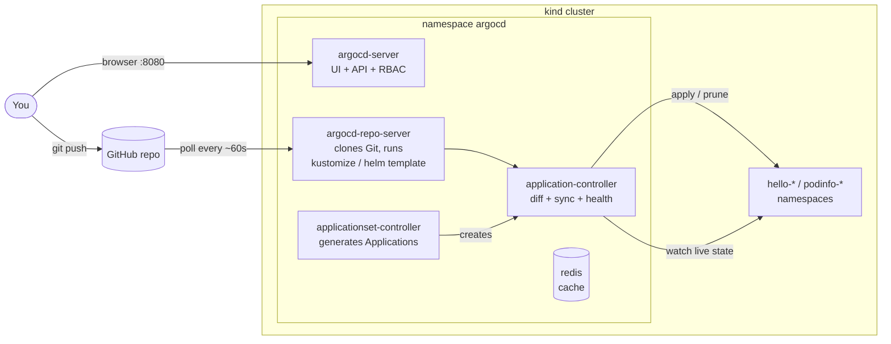
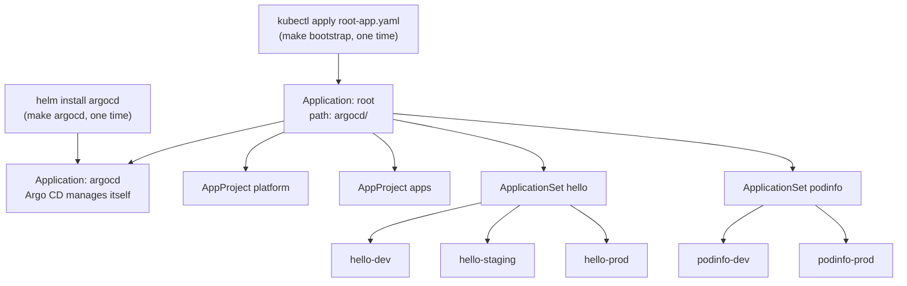

# Argo CD concepts, explained with this repo

Each section explains one concept and points at the file in this repo that uses it.

## 1. GitOps in one paragraph

GitOps means **Git is the single source of truth for what runs in the cluster**.
A controller *inside* the cluster continuously compares the **desired state** (Git)
with the **live state** (the cluster) and reconciles any difference. Nobody runs
`kubectl apply` or `helm upgrade` against the cluster: you change Git, and the
cluster follows. The [OpenGitOps principles](https://opengitops.dev/) put it as:
*declarative*, *versioned & immutable*, *pulled automatically*, *continuously reconciled*.

**Pull vs push.** A classic CI/CD pipeline *pushes* to the cluster, so it needs cluster
credentials. With Argo CD the cluster *pulls* from Git. CI never touches the
cluster, every change is auditable through Git history, and rollback is a `git revert`.

## 2. Argo CD architecture

| Component | Role |
|---|---|
| **repo-server** | Clones the repo and renders plain manifests (`kustomize build`, `helm template`, plain YAML). Stateless. |
| **application-controller** | The brain. Compares rendered (desired) vs live state, computes sync & health status, applies changes. |
| **applicationset-controller** | Turns one `ApplicationSet` template + generators into N `Application`s. |
| **server** | UI, REST/gRPC API, authentication (local users / SSO) and RBAC. |
| **redis** | Cache for rendered manifests and the live-state tree. |
| **dex** | SSO bridge (GitHub, OIDC, LDAP…). **Disabled** here, see [decisions](decisions.md). |

## 3. The resources Argo CD adds to Kubernetes (CRDs)

### Application: "deploy *this* from Git *there*"

`source` (repo + path/chart + revision) → `destination` (cluster + namespace), plus a `syncPolicy`.
See [`bootstrap/root-app.yaml`](../bootstrap/root-app.yaml).

### AppProject: guard rails / multi-tenancy

Restricts which **repos** an app may use, which **clusters/namespaces** it may deploy to,
and which **resource kinds** it may create. Projects are also the unit RBAC policies apply to.

- [`argocd/projects/platform.yaml`](../argocd/projects/platform.yaml): permissive, for Argo CD itself.
- [`argocd/projects/apps.yaml`](../argocd/projects/apps.yaml): restrictive. Only `hello-*`/`podinfo-*`
  namespaces, only `Namespace` at cluster scope, no `ResourceQuota`/`LimitRange`.

### ApplicationSet: an Application factory

One template + **generators** → many Applications. Generators used here:

| Generator | File | Produces |
|---|---|---|
| **Git directory** | [`hello-appset.yaml`](../argocd/apps/hello-appset.yaml) | one app per folder in `apps/hello/overlays/*` |
| **List** | [`podinfo-appset.yaml`](../argocd/apps/podinfo-appset.yaml) | one app per listed environment |

Others worth knowing: **cluster** (one app per registered cluster), **matrix/merge**
(combine generators), **SCM provider / pull request** (preview environments per PR).

`templatePatch` (Go template) lets the generated apps differ, which is how prod gets
*manual* sync while dev/staging get *automated* sync.

## 4. Bootstrapping: app-of-apps + self-management

- **App of apps**: the `root` Application's source is a folder that contains *other*
  Argo CD resources. Applying one manifest by hand is enough to recreate everything.
- **Self-management**: [`argocd/apps/argocd.yaml`](../argocd/apps/argocd.yaml) points at the
  same Helm chart + values that were used for the first install. From then on, upgrading or
  reconfiguring Argo CD is a pull request.

## 5. Sync: status, policy, options

**Sync status**: is the live state equal to Git? `Synced` / `OutOfSync`.
**Health status**: is it actually working? `Healthy` / `Progressing` / `Degraded` / `Missing` / `Suspended`.
Argo CD has built-in health checks for core kinds (a Deployment is Healthy when its
rollout completed and pods are Ready, which is why the readiness probes matter). Custom
health checks can be written in Lua.

| Setting | Meaning | Used in |
|---|---|---|
| `automated` | sync automatically when Git changes | dev, staging, root, argocd |
| `automated.selfHeal` | also revert **manual changes** in the cluster (drift) | same |
| `automated.prune` | delete resources that were **removed from Git** | apps (not argocd, on purpose) |
| no `automated` | human must press SYNC | prod |
| `CreateNamespace=true` | create the destination namespace if missing | ApplicationSets |
| `ServerSideApply=true` | use SSA (needed for Argo CD's very large CRDs) | argocd |
| `retry` | retry failed syncs with backoff | hello ApplicationSet |
| `resources-finalizer` | deleting the app also deletes its resources (cascade) | root, generated apps |

## 6. Sync waves and hooks: ordering within a sync

A single sync runs in **phases** (`PreSync` → `Sync` → `PostSync`, plus `SyncFail`) and,
inside each phase, in **waves** (lowest `argocd.argoproj.io/sync-wave` first; Argo CD
waits for each wave to be Healthy before starting the next).

In [`apps/hello/base`](../apps/hello/base):

| Order | Resource | Mechanism |
|---|---|---|
| 1 | `hello-db-migration` Job | `hook: PreSync`. If it fails, nothing else is applied. |
| 2 | `hello-config-<hash>` ConfigMap | `sync-wave: "0"` |
| 3 | `hello` Deployment + Service | `sync-wave: "1"` |
| 4 | `hello-smoke-test` Job | `hook: PostSync`, runs only once everything is Healthy |

The same idea at the bootstrap level: projects are wave `-2`, Argo CD itself `-1`,
ApplicationSets `0` (see the `root` tree above).

`hook-delete-policy: BeforeHookCreation` keeps the last run's Job (and its logs) until the next sync.

## 7. Config sources: Kustomize, Helm, multi-source

- **Kustomize** (`hello`): a `base` plus one small `overlay` per environment. The overlay
  only contains what *differs*. `configMapGenerator` adds a content hash to the ConfigMap
  name, so a config change triggers a rolling update automatically.
- **Helm** (`podinfo`): Argo CD runs `helm template` and applies the result. Helm is only
  a templating engine here: there are no Helm releases/`helm ls` for Argo CD-managed charts.
- **Multi-source** (`podinfo`, `argocd`): the chart comes from the vendor's Helm repo,
  the values come from *our* Git repo (`ref: values` → `$values/...`). No chart forking.

## 8. Rollback

Two ways, with a difference worth knowing:

1. **`git revert`** (preferred). Git stays the source of truth, and auto-sync deploys the revert.
2. **`argocd app rollback <app> <history-id>`** (or *History and rollback* in the UI)
   re-syncs an older revision. It is **refused while auto-sync is enabled**, because
   auto-sync would immediately undo it. It's an emergency tool for manually-synced apps like prod.

## 9. Security model (RBAC)

- Local users are declared in `argocd-cm` (`accounts.<name>`), with passwords as bcrypt
  hashes in `argocd-secret`. Here: `admin` (initial random password) and `viewer`.
- Policies live in `argocd-rbac-cm` as Casbin CSV lines (see `configs.rbac` in
  [`bootstrap/argocd-values.yaml`](../bootstrap/argocd-values.yaml)):
  `p, <subject>, <resource>, <action>, <project>/<object>, allow|deny` and `g, <user/group>, <role>`.
- `viewer` is bound to the built-in `role:readonly`, so they can see everything and change nothing
  (`make demo-rbac`).
- In production you would disable `admin`, log in through SSO (Dex/OIDC), and map SSO
  groups to roles, often per AppProject.
